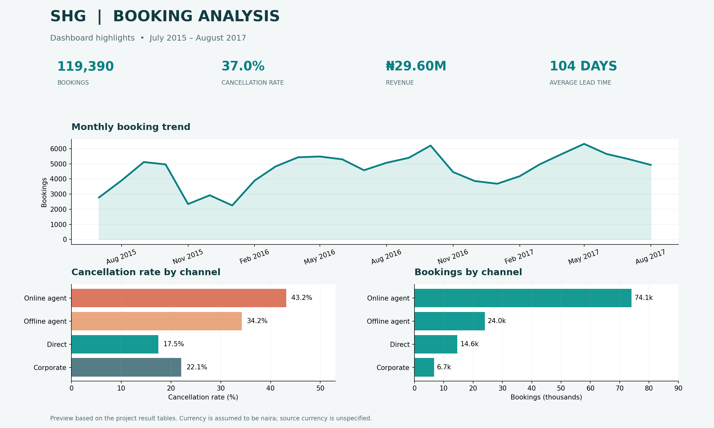

# 🏨 Splendor Hotel Groups — Booking Performance Analysis

> I used **Microsoft Excel** to analyse hotel booking performance, identify cancellation patterns, and turn the findings into practical recommendations for SHG. I present the results in an interactive HTML dashboard for browser viewing.

---

## 📌 Project Overview

High booking volume does not always translate into retained revenue. I examined **119,390 bookings** across the City and Resort hotels, covering arrivals from **July 2015 to August 2017**, to understand where bookings came from, when guests cancelled, and which segments contributed the most revenue.

I focused on four business questions: How do bookings change over time? Which channels bring valuable bookings? How does lead time relate to cancellations? Where can SHG improve revenue retention?

---

## 🗂️ Repository Structure

| File or folder | Contents |
|---|---|
| [docs/index.html](docs/index.html) | My SHG Booking Performance Dashboard, provided as an interactive HTML file |
| [images/dashboard-preview.png](images/dashboard-preview.png) | Static summary of selected findings |
| [reports/SHG_Analysis_Report.md](reports/SHG_Analysis_Report.md) | Detailed findings and recommendations |
| [documentation/](documentation/) | Project brief, data dictionary, and methodology |
| [outputs/tables/](outputs/tables/) | 41 supporting result tables in CSV format |
| [data/raw/](data/raw/) | Original dataset, compressed as `.md.gz` |
| [data/processed/](data/processed/) | Cleaned dataset, compressed as `.csv.gz` |
| [src/](src/) | Supplementary Python scripts for reproducing calculations and modelling |
| [dashboard/template.html](dashboard/template.html) | HTML template used by the supplementary dashboard build script |
| [requirements.txt](requirements.txt) | Dependencies for the supplementary Python scripts |

---

## 🔍 My Analysis

I used Microsoft Excel to examine booking trends, revenue, cancellations, customer segments, and booking lead times. I compared the City and Resort hotels and reviewed results by distribution channel, customer type, deposit type, and country.

I paid particular attention to data quality. I identified **35,284 rows** that match another row on every field except Booking ID. I retained them in the headline results and compared the results with those rows excluded. I also separated valid daily rates and completed stays when interpreting the averages.

---

## 📊 Booking Performance Dashboard

I use the [SHG Booking Performance Dashboard](docs/index.html) to present the following measures and comparisons.

| Dashboard section | What I show |
|---|---|
| KPI cards | Bookings, revenue collected, revenue lost to cancellations, cancellation rate, average daily rate, average stay, and average lead time |
| Bookings and revenue by arrival month | Monthly booking volume alongside revenue collected |
| Price and cancellations through the year | Average daily rate compared with cancellation rate |
| Lead time | Cancellation rate and revenue per booking across booking lead-time bands |
| Revenue collected and lost by channel | Retained revenue and cancellation losses across the four main channels |
| Segment tables | Distribution channels, customer types, deposit types, and countries of origin |

I can filter the charts, KPI cards, and tables by **hotel, channel, customer type, deposit type, country, lead time, and arrival year**. I can also exclude duplicate rows and reset all selections. The written findings describe the full dataset and remain fixed when filters change.

### Summary preview



*This image summarises selected results. The interactive HTML dashboard contains the full set of charts, tables, and filters described above.*

---

## 💡 Key Findings

- **I found that cancellations affected 37.0% of bookings.** Recorded revenue collected was **₦29.60 million**, while cancellation losses were **₦13.12 million**. This represents 69.3% of the recorded potential revenue.
- **I identified online travel agents as the largest source of bookings and losses.** They contributed 62.0% of bookings but 82.2% of lost revenue. Their cancellation rate was 43.2%, compared with 17.5% for direct bookings.
- **I found revenue growth alongside rising cancellations.** Revenue for January–August 2017 was 21.7% higher than in the same months of 2016, while cancellations rose from 34.7% to 38.7%.
- **I observed higher cancellation rates for bookings made far in advance.** Bookings made more than 180 days ahead cancelled at roughly 55%–68%, compared with 9.6% for bookings made within a week.
- **I found marked differences between source markets.** Portugal supplied 40.7% of bookings and had a cancellation rate of 56.6%. The UK, Germany, and France had rates of about 17%–20%.
- **I found that corporate bookings offered a lower-rate segment.** They represented 5.6% of bookings, with an average daily rate of ₦71.4, compared with ₦103.5 overall.

**Currency note:** I present monetary values in naira (₦) as a reporting assumption. The source does not specify a currency, and no conversion was applied. The HTML dashboard uses rounded aggregates, so small differences from the detailed result tables may occur.

---

## 🎯 My Recommendations

1. **Grow direct bookings.** I recommend targeted direct-booking offers because this channel combines relatively low cancellations with strong revenue per booking.
2. **Review cancellation terms for online travel agents.** I recommend testing deposits, clearer cancellation windows, and pre-arrival confirmation to reduce avoidable losses.
3. **Monitor long-lead bookings.** I recommend earlier confirmation and follow-up for bookings made more than six months before arrival.
4. **Use seasonal pricing carefully.** I recommend aligning rates and promotions with demand patterns while tracking cancellation rates alongside booking growth.
5. **Resolve data-quality questions before changing deposit policy.** I recommend checking duplicate records and the unusually high cancellation rate among non-refundable bookings with the data owner.

---

## 🛠️ Tools Used

- **Microsoft Excel** — my primary tool for the booking performance analysis and reporting.
- **HTML, JavaScript, and Chart.js** — the browser version of the interactive dashboard supplied in this repository.
- **Python** — supplementary scripts included for calculation checks, reproducibility, and additional cancellation modelling. The predictive model is a separate Python extension, not an Excel feature.

---

## 📝 Data Notes and Limitations

- I included duplicate records in the headline figures. Excluding them reduces the cancellation rate to approximately 28.2%.
- I treated the cancellation flag as including **1,207 no-shows**.
- I excluded zero and negative rates and the daily-rate outlier of 5,400 from average daily rate calculations.
- I used completed stays of at least one night for average stay calculations.
- I analysed corporate bookings as a **distribution channel**, because Corporate is not a customer-type category in this dataset.
- I could not measure customer satisfaction, net profit, or RevPAR directly because satisfaction scores, operating costs, commissions, and available-room inventory are not provided.
- I treated seasonal comparisons cautiously because 2016 is the only complete calendar year in the dataset.

I document the definitions and supplementary calculations in [Methodology](documentation/methodology.md).

---

## 📁 How to View the Project

1. Select **Code → Download ZIP** and extract the downloaded folder.
2. Open **`docs/index.html`** in a browser to use the dashboard. An internet connection is needed to load Chart.js and the web fonts.
3. Read the [full report](reports/SHG_Analysis_Report.md) and open the CSV files in `outputs/tables/` in Microsoft Excel to review the supporting results.
4. Extract the `.gz` datasets if you want to inspect the raw Markdown table or cleaned CSV.

The HTML file is a browser presentation, not an Excel workbook. This repository currently contains the HTML dashboard, datasets, result tables, report, and supplementary scripts; an `.xlsx` workbook is not included.

<details>
<summary>Run the supplementary Python pipeline</summary>

```bash
python -m venv .venv
# Windows: .venv\Scripts\activate
# macOS/Linux: source .venv/bin/activate
pip install -r requirements.txt
cd src
python 01_prepare_data.py
python 02_analysis.py
python 03_cancellation_model.py
python 04_build_dashboard.py
```

These scripts regenerate the processed data, result tables, and HTML dashboard from the template. They read the compressed datasets directly.

</details>

---

## 👤 Author

**Emmanuel Kebodi Friday**  
Data Analyst | Lagos, Nigeria

[LinkedIn](https://www.linkedin.com/in/emmyk7/) · [GitHub](https://github.com/emmyk77)
